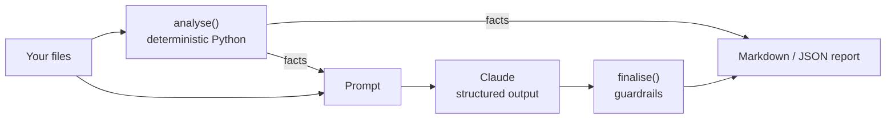

# QA AI Agents

Ten Claude-powered agents for the everyday work of a QA team, from refining a user story to the go / no-go decision for a release.

Each agent does two things:

1. **Deterministic analysis in plain Python.** This covers boundary values, OpenAPI gaps, static code smells, flip rates, change-to-test mapping and quality gates. These numbers are exact, are tested, and never come from the model.
2. **Claude for judgment.** Claude handles classification, root causes, wording and recommendations. It receives the computed facts and must not contradict them, and it answers through [structured outputs](https://platform.claude.com/docs/en/build-with-claude/structured-outputs), so every response is validated against a Pydantic schema.

Where a wrong answer would be costly, **guardrails** in code have the last word. For example, the release agent can never say "go" while a quality gate fails, and the regression agent always keeps smoke and P1 tests for changed modules.

There are two ways to use it:

- **Command line / CI:** `qa-agents run ...` calls the Claude API and writes a Markdown or JSON report.
- **Claude Code skills:** ten skills in [`.claude/skills/`](.claude/skills/) let you ask Claude Code in plain English ("triage the failed tests", "is this release ready?"). The skill runs the same Python analysis, Claude Code does the judgment, and it can then act: fix the test, rerun it, write the contract tests. No API key is needed.

> **Try it without an API key:** `--demo` replays recorded responses. The locally computed facts are still real.

## The agents

| # | Agent | Input | What it computes locally | What Claude adds |
|---|---|---|---|---|
| 1 | `requirement-review` | User stories (`.md`) | Acceptance-criteria count, Given/When/Then lines, vague terms | Readiness verdict, missing criteria, edge cases, questions for the PO |
| 2 | `test-case-generation` | Requirements (`.md`) | Numeric limits and boundary probe values (n-1, n, n+1) | Positive, negative, boundary and integration cases with data and expected results |
| 3 | `api-contract` | OpenAPI 3 (`.yaml`/`.json`) | Endpoints, required fields, constraints, spec gaps (auth, 4xx, limits) | Request validations, negative tests with status codes, schema checks |
| 4 | `code-review` | Test code (`.ts`, `.java`, `.py`...) | Fixed waits, unstable locators, hardcoded data, weak assertions, duplicate blocks (with line numbers) | Confirms or dismisses each finding, finds what regex can't, suggests fixes |
| 5 | `failure-analysis` | JUnit XML + logs | Failed tests, keyword hint per failure | App defect / automation / test data / environment, with evidence and owner |
| 6 | `flaky-tests` | Execution history (`.csv`) | Fail rate, flip rate, duration variance, error signatures, failures per env | Root cause type, fix and quarantine decision per test |
| 7 | `defect-drafting` | Logs, API JSON, screenshots, notes | Error lines, HTTP statuses, request ids, time window | A complete bug report: steps, expected/actual, severity, evidence |
| 8 | `regression-selection` | Changed files, test map (`.yaml`), defect history | Direct/indirect module impact, risk-scored test ranking, unmapped files | must / should / optional per test, hidden risks. **Guardrail:** smoke and P1 tests are always kept |
| 9 | `execution-report` | JUnit XML, defects (`.csv`), progress (`.yaml`) | Pass rate, per-suite results, slowest tests, defects by severity | Headline, status, highlights, concerns, next steps |
| 10 | `release-readiness` | JUnit XML, defects, risks, criteria (`.yaml`) | Quality gates, risk scores (likelihood x impact) | Go / conditions / no-go with rationale. **Guardrail:** no "go" while a gate fails |

See [`sample-reports/`](sample-reports/) for the output of every agent on the bundled examples.

## Built on published QA practice

Each agent carries an expert checklist with its sources in [`qa_agents/knowledge/`](qa_agents/knowledge/). The checklist is part of the agent's instructions, and the matching skill holds a copy in its folder.

| Agent | Grounded in |
|---|---|
| Requirement review | ISO/IEC/IEEE 29148:2018, INVEST, ISTQB CTFL v4.0.1, NASA ARM weak-phrase lists, requirements smells (Femmer et al.), ISO/IEC 25010:2023, WCAG 2.2 |
| Test case generation | ISTQB CTFL v4.0.1 techniques (EP, 3-value BVA, decision tables, state transitions), NIST combinatorial testing, ISO/IEC/IEEE 29119-3, Hendrickson's Test Heuristics Cheat Sheet |
| API contract | OWASP API Security Top 10 2023, RFC 9110 / 6585 status codes, RFC 9457 Problem Details, Spectral OpenAPI rules, Pact, oasdiff breaking-change rules |
| Code review | Test-smell catalogue (van Deursen et al.; tsDetect), official Playwright / Cypress / Selenium guidance, OWASP Secrets Management Cheat Sheet |
| Failure analysis | False-alarm research (Herzig & Nagappan, Microsoft), Maven Surefire rerun semantics |
| Flaky tests | Luo et al. FSE 2014, Eck et al. FSE 2019, iDFlakies, Gruber et al. 2022, flip rate (Kowalczyk et al., Apple), Google Testing Blog |
| Defect drafting | "What Makes a Good Bug Report?" (Bettenburg, Zimmermann et al. FSE 2008), ISO/IEC/IEEE 29119-3, ISTQB severity vs priority |
| Regression selection | Yoo & Harman survey, safe vs unsafe selection (Rothermel & Harrold), Google CI research (Elbaum et al.; Memon et al.) |
| Execution report | ISTQB CTFL v4.0.1 progress and completion reports and metrics |
| Release readiness | ISTQB risk level and exit criteria, SonarQube quality gates, Google SRE canarying and rollback, DORA metrics |

## Foolproof by design

- **Messy inputs:** UTF-8 with or without a BOM, UTF-16 Windows exports, comma or semicolon CSVs, Jira and Azure DevOps column names and severity scales, Swagger 2.0 and OpenAPI 3.0/3.1, nested or Surefire-rerun JUnit XML, `git diff --name-status` renames and Windows paths.
- **Clear errors instead of crashes:** empty, binary, oversized or malformed files, an invalid test map or criteria, and missing columns each produce one actionable message that names the file.
- **Fail-safe defaults:**
  - An unknown defect status counts as open.
  - A risk with an unrated likelihood or impact counts as high.
  - Missing defect data fails the defect gates.
  - Skipped smoke tests fail the smoke gate.
- **Guardrails in code:**
  - No "go" while a gate fails.
  - Smoke and P1 tests are always kept, and build or dependency changes force a full-suite recommendation.
  - Unused boundary values and duplicate test IDs are reported.
- **Prompt-injection aware:** input files are treated as data, never as instructions.
- **Model output checked:** structured outputs are validated against Pydantic schemas, and a refusal, a truncated answer or an API error each produce a clear message.



## Quick start

```bash
git clone https://github.com/AwaisAshrafQA/qa-ai-agents.git
cd qa-ai-agents
pip install -e ".[dev]"

qa-agents list
qa-agents example release-readiness --demo     # one agent, recorded response
qa-agents example all --demo --out reports     # all ten, written to ./reports
pytest -q                                       # 110 tests, no API key needed
```

## Using the Claude Code skills

| Skill | Ask Claude Code something like |
|---|---|
| `qa-requirement-review` | "Is SL-101 ready for development?" |
| `qa-test-case-generation` | "Write test cases for the coupon requirement" |
| `qa-api-contract` | "What should we test in openapi.yaml?" |
| `qa-code-review` | "Review the tests changed in this branch" |
| `qa-failure-analysis` | "Why did last night's run fail?" |
| `qa-flaky-tests` | "Which tests are flaky and why?" |
| `qa-defect-drafting` | "Write a bug from this log and screenshot" |
| `qa-regression-selection` | "What should we regression-test for this PR?" |
| `qa-execution-report` | "Write today's QA status report" |
| `qa-release-readiness` | "Is 2.4.0 ready to ship?" |

**In this repository:** open it in Claude Code and the skills load automatically.

**In your own project:** install the package and copy the skills into your user skills folder:

```bash
pip install git+https://github.com/AwaisAshrafQA/qa-ai-agents
```

```bash
cp -r .claude/skills/qa-* ~/.claude/skills/
```

Each skill follows the same four steps:

1. Run `qa-agents facts <agent> <files>`, which prints the exact facts, the agent's instructions, the output fields and any guardrails as JSON. No model call is made.
2. Claude Code reads the facts and the source files and does the analysis.
3. It writes the report in the agent's structure, keeping the guardrails (for example, no "go" while a quality gate fails).
4. It offers concrete next steps, such as fixing the test or rerunning it, and asks before changing anything.

Both ways share the same instructions and facts, so the CLI and the skills never drift apart. The tests check that every agent has a matching skill.

## Using it with Claude

Create an API key in the [Claude Console](https://platform.claude.com/), then set it as an environment variable. Never commit the key.

```bash
export ANTHROPIC_API_KEY=...            # PowerShell: $env:ANTHROPIC_API_KEY="..."

qa-agents run failure-analysis target/surefire-reports/*.xml logs/app.log
qa-agents run code-review tests/checkout.spec.ts --out review.md
qa-agents run release-readiness results.xml defects.csv risks.yaml criteria.yaml --json
```

Options:

| Option | Default | Meaning |
|---|---|---|
| `--model` | `claude-opus-5-5` (or `$QA_AGENTS_MODEL`) | Claude model id |
| `--effort` | `high` | `low`, `medium`, `high`, `xhigh` or `max`: thinking depth versus cost |
| `--json` | off | JSON (facts + output) instead of Markdown |
| `--out` | stdout | Write to a file |
| `--demo` | off | Recorded responses, no API calls |

`qa-agents facts <agent> <files>` prints only the deterministic analysis as JSON, without calling Claude.

### In CI

Run an agent after your test stage and publish the report as a build artifact. For example, in GitHub Actions:

```yaml
- name: Triage failures
  if: failure()
  env:
    ANTHROPIC_API_KEY: ${{ secrets.ANTHROPIC_API_KEY }}
  run: qa-agents run failure-analysis reports/junit/*.xml --out triage.md
```

## Input formats

- **JUnit XML:** the standard format from JUnit, TestNG, pytest, Playwright, Cypress and most CI tools.
- **Defects CSV:** columns `id,title,severity,status,module` (a Jira or Azure DevOps export works).
- **Execution history CSV:** `run_id,timestamp,test,status,duration_ms,error,env`.
- **Test map YAML:** modules with path globs, `depends_on` and tests (see [`examples/regression-selection/test_map.yaml`](examples/regression-selection/test_map.yaml)).
- **Release criteria YAML:** `min_pass_rate`, `max_open_critical`, `max_open_major`, `require_smoke_pass`, `max_high_risks_without_mitigation`.

## Project layout

```
qa_agents/
  core/        llm.py (Claude + demo client), base.py (agent lifecycle), render.py (Markdown)
  tools/       junit.py, defects.py, openapi.py, text.py: shared parsers
  knowledge/   one expert checklist per agent, with sources
  agents/      one module per agent: schema, prompt, analyse(), finalise()
  demo/        recorded responses for --demo
examples/      made-up sample inputs for each agent (fictional "ShopLite" store)
sample-reports/  generated output for each agent
tests/         pytest: deterministic logic, guardrails, CLI, API client (mocked HTTP), skills
.claude/skills/  one Claude Code skill per agent
```

## Adding an agent

Subclass `Agent`, define a Pydantic `output_model`, a `system_prompt` and `build_prompt()`. Optionally add `analyse()` for deterministic facts and `finalise()` for guardrails. Register the agent in `qa_agents/agents/__init__.py`, add a recorded response in `qa_agents/demo/`, an expert checklist in `qa_agents/knowledge/<name>.md` and a skill in `.claude/skills/qa-<name>/SKILL.md`, then run `python scripts/sync_skill_references.py`. The tests fail if any of these are missing or out of sync.

## Data and privacy

Agent inputs are sent to the Anthropic API when you run without `--demo`, or to Claude Code when you use the skills. Don't send secrets, production credentials or customer personal data; mask them first. All sample data in this repository is made up.

## License

MIT. Built by [Awais Ashraf](https://awaisashrafqa.github.io), Senior QA Automation Engineer.
