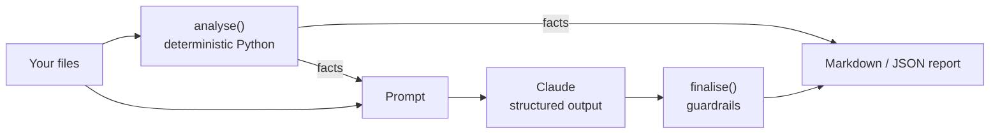

# QA AI Agents

Ten Claude-powered agents for the everyday work of a QA team, from refining a user story to the go / no-go decision for a release.

Each agent does two things:

1. **Deterministic analysis in plain Python.** This covers boundary values, OpenAPI gaps, static code smells, flip rates, change-to-test mapping and quality gates. These numbers are exact, are tested, and never come from the model.
2. **Claude for judgment.** Claude handles classification, root causes, wording and recommendations. It receives the computed facts and must not contradict them, and it answers through [structured outputs](https://platform.claude.com/docs/en/build-with-claude/structured-outputs), so every response is validated against a Pydantic schema.

Where a wrong answer would be costly, **guardrails** in code have the last word. For example, the release agent can never say "go" while a quality gate fails, and the regression agent always keeps smoke and P1 tests for changed modules.

> **Try it without an API key:** `--demo` replays recorded responses. The locally computed facts are still real.

## The agents

| # | Agent | Input | What it computes locally | What Claude adds |
|---|---|---|---|---|
| 1 | `requirement-review` | User stories (`.md`) | Acceptance-criteria count, Given/When/Then lines, vague terms | Readiness verdict, missing criteria, edge cases, questions for the PO |
| 2 | `test-case-generation` | Requirements (`.md`) | Numeric limits and boundary probe values (n-1, n, n+1) | Positive, negative, boundary and integration cases with data and expected results |
| 3 | `api-contract` | OpenAPI 3 (`.yaml`/`.json`) | Endpoints, required fields, constraints, spec gaps (auth, 4xx, limits) | Request validations, negative tests with status codes, schema checks |
| 4 | `code-review` | Test code (`.ts`, `.java`, `.py`...) | Fixed waits, unstable locators, hardcoded data, weak assertions, duplicate blocks (with line numbers) | Confirms or dismisses each finding, finds what regex can't, suggests fixes |
| 5 | `failure-analysis` | JUnit XML + logs | Failed tests, keyword hint per failure | App defect / automation / test data / environment, with evidence and owner |
| 6 | `flaky-tests` | Execution history (`.csv`) | Fail rate, flip rate, duration variance, error signatures, failures per env | Root cause type, fix and quarantine decision per test |
| 7 | `defect-drafting` | Logs, API JSON, screenshots, notes | Error lines, HTTP statuses, request ids, time window | A complete bug report: steps, expected/actual, severity, evidence |
| 8 | `regression-selection` | Changed files, test map (`.yaml`), defect history | Direct/indirect module impact, risk-scored test ranking, unmapped files | must / should / optional per test, hidden risks. **Guardrail:** smoke and P1 tests are always kept |
| 9 | `execution-report` | JUnit XML, defects (`.csv`), progress (`.yaml`) | Pass rate, per-suite results, slowest tests, defects by severity | Headline, status, highlights, concerns, next steps |
| 10 | `release-readiness` | JUnit XML, defects, risks, criteria (`.yaml`) | Quality gates, risk scores (likelihood x impact) | Go / conditions / no-go with rationale. **Guardrail:** no "go" while a gate fails |

See [`sample-reports/`](sample-reports/) for the output of every agent on the bundled examples.



## Quick start

```bash
git clone https://github.com/AwaisAshrafQA/qa-ai-agents.git
cd qa-ai-agents
pip install -e ".[dev]"

qa-agents list
qa-agents example release-readiness --demo     # one agent, recorded response
qa-agents example all --demo --out reports     # all ten, written to ./reports
pytest -q                                       # 38 tests, no API key needed
```

## Using it with Claude

Create an API key in the [Claude Console](https://platform.claude.com/), then set it as an environment variable. Never commit the key.

```bash
export ANTHROPIC_API_KEY=...            # PowerShell: $env:ANTHROPIC_API_KEY="..."

qa-agents run failure-analysis target/surefire-reports/*.xml logs/app.log
qa-agents run code-review tests/checkout.spec.ts --out review.md
qa-agents run release-readiness results.xml defects.csv risks.yaml criteria.yaml --json
```

Options:

| Option | Default | Meaning |
|---|---|---|
| `--model` | `claude-opus-5-5` (or `$QA_AGENTS_MODEL`) | Claude model id |
| `--effort` | `high` | `low`, `medium`, `high`, `xhigh` or `max`: thinking depth versus cost |
| `--json` | off | JSON (facts + output) instead of Markdown |
| `--out` | stdout | Write to a file |
| `--demo` | off | Recorded responses, no API calls |

### In CI

Run an agent after your test stage and publish the report as a build artifact. For example, in GitHub Actions:

```yaml
- name: Triage failures
  if: failure()
  env:
    ANTHROPIC_API_KEY: ${{ secrets.ANTHROPIC_API_KEY }}
  run: qa-agents run failure-analysis reports/junit/*.xml --out triage.md
```

## Input formats

- **JUnit XML:** the standard format from JUnit, TestNG, pytest, Playwright, Cypress and most CI tools.
- **Defects CSV:** columns `id,title,severity,status,module` (a Jira or Azure DevOps export works).
- **Execution history CSV:** `run_id,timestamp,test,status,duration_ms,error,env`.
- **Test map YAML:** modules with path globs, `depends_on` and tests (see [`examples/regression-selection/test_map.yaml`](examples/regression-selection/test_map.yaml)).
- **Release criteria YAML:** `min_pass_rate`, `max_open_critical`, `max_open_major`, `require_smoke_pass`, `max_high_risks_without_mitigation`.

## Project layout

```
qa_agents/
  core/        llm.py (Claude + demo client), base.py (agent lifecycle), render.py (Markdown)
  tools/       junit.py, defects.py, openapi.py: shared parsers
  agents/      one module per agent: schema, prompt, analyse(), finalise()
  demo/        recorded responses for --demo
examples/      made-up sample inputs for each agent (fictional "ShopLite" store)
sample-reports/  generated output for each agent
tests/         pytest: deterministic logic, guardrails, CLI, API client (mocked HTTP)
```

## Adding an agent

Subclass `Agent`, define a Pydantic `output_model`, a `system_prompt` and `build_prompt()`. Optionally add `analyse()` for deterministic facts and `finalise()` for guardrails. Register the agent in `qa_agents/agents/__init__.py` and add a recorded response in `qa_agents/demo/`.

## Data and privacy

Agent inputs are sent to the Anthropic API when you run without `--demo`. Don't send secrets, production credentials or customer personal data; mask them first. All sample data in this repository is made up.

## License

MIT. Built by [Awais Ashraf](https://awaisashrafqa.github.io), Senior QA Automation Engineer.
